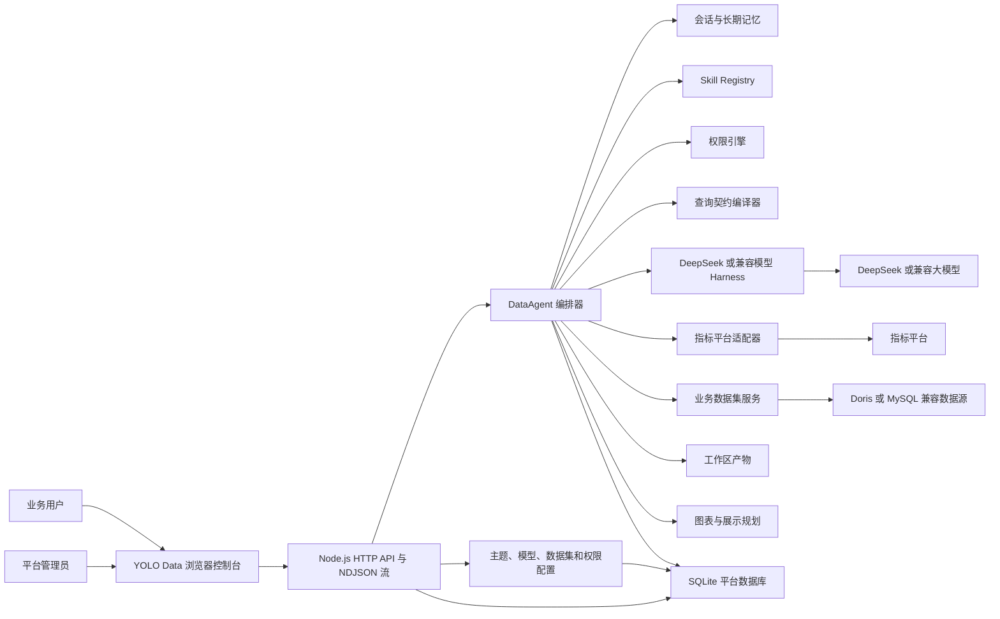

# YOLO Data

面向企业的智能问数平台。YOLO Data 将大模型(LLM)、Agent、指标体系、业务数据集、数据权限、会话记忆和工作区产物整合为一条可审计、可复现、可治理的工作流。帮助企业简化繁杂的数据分析与处理流程，快速稳定进行数据分析与洞察。业务可以对同一个问题进行多轮追问，当需要用户澄清时主动反问。

## 主要解决的问题

1. 准确性：Text2SQL的架构每次回答不一致，答案随机性强，本产品核心工作流主要解决大模型幻觉问题，准确率提升至95%+。
2. 一致性：语义层不统一，业务各说各话，决策者不知道哪份数据真实。
3. 效率：现有组织架构数据处理“出数>归因>决策>执行”流程过长；效率从小时级别提升到分钟级。

## 项目定位

企业数据问数不能只依赖将数据表Schema扔给大模型，需要大模型能结合上下文将复杂问题进行拆解；通过类似数据加工的方式精准的输出数据结果，能根据问题进行洞察与归因分析。

1. 模型负责理解用户问题、指标口径和字段。
2. 平台负责时间解析、字段映射、查询契约、权限绑定和结果稳定化。
3. 最终查询只能从已治理的指标或业务数据集中执行。
4. 所有关键步骤保留证据，可审计、可复现、可回放。

## 页面截图

 

 


## 核心能力

- **实时指标体系**
  - 对接指标目录、指标详情、口径、维度和聚合查询。
  - 不复制指标库，不把缓存当作指标事实来源。
- **智能体**
  - 每个主题独立配置提示词、模型、Skills、指标范围、数据集范围和默认口径。
  - 一个主题就是一个独立的业务 DataAgent。
- **统一模型管理**
  - 模型新增、编辑、删除、密钥加密、Base URL、温度、工具轮次和平台默认模型管理。
  - 主题可以绑定多个模型，并指定默认运行模型。
- **业务数据集**
  - 支持 MySQL、TiDB、Doris，以及 PostgreSQL 数据源（需安装可选驱动 `pg`，参见 [PostgreSQL 接入](docs/postgresql.md)）。
  - 平台根据字段语义生成只读查询，不向模型暴露原始 SQL。
  - 支持字段同步、抽样、默认枚举值域和数据集查询审计。
  - 支持「智能识别」：抽样数据自动推断时间字段、常用指标与默认时间窗口，管理员确认后写入字段口径。
- **Contract-first 契约先行查询**
  - 自然语言被编译为条件账本和查询契约。
  - 查询契约冻结后才允许执行。
  - 时间范围、权限、排序和结果行序由平台确定性处理。
- **通用分析管线**
  - 支持时间分桶、派生公式、多条件资格筛选、Rollup 计数、多键排序、Top-N 和列投影。
  - 适合连续月份达标、派生排序、复杂客户筛选等场景。
- **数据权限**
  - 主题级、指标级、数据集级授权。
  - 行级策略强制覆盖模型同字段条件。
  - 列级策略支持隐藏和脱敏。
- **多轮会话与工作区**
  - 会话记忆与长期记忆均按用户和主题隔离；长期记忆沉淀成按「用户 × 智能体」的 Markdown 手册，注入摘要、按需检索正文，并自动合并笔记、压缩超长正文。
  - 查询结果、代码执行结果、CSV、JSON、XLSX 输出均保留为工作区产物。
  - 追问优先复用已有数据快照，避免重复取数造成结果漂移。
- **Skills**
  - 支持标准 `SKILL.md` 目录扫描。
  - 公共 Skills 支持管理员上传、启停、删除与引用管理，参见 [Skill 上传与验收](docs/skill-upload.md)。
  - 支持规划前审计、规划约束、执行后结果验证。
  - 平台核心不写死具体行业口径。
- **可观测性**
  - 十三阶段 DataAgent Workflow（含代码驱动分析阶段）。
  - 流式执行事件、工具调用、查询计划、LLM Token、反馈和知识缺口。

## 业务规则与提示词设置

提示词用于展示效果或结论能够按照业务要求自由定义；业务词、枚举映射、计算公式和默认口径应放在：

- 主题提示词，参考docs/theme-prompts/sales-operation.md
- 数据集字段说明
- 默认值域配置


## 总体架构




## 环境要求

- Node.js `>= 22.5`（平台库使用 Node 内置 `node:sqlite`，无需安装数据库服务）
- npm 或 pnpm
- 可选：Python 3，用于高级数据处理和文件生成（`.xlsx` 生成需要该解释器装有 `pandas` + `openpyxl`）
- 或：Docker + Docker Compose，一条命令启动完整平台，无需本机 Node/Python（见 [Docker 一键部署](#docker-一键部署)）
- 可选外部服务：
  - 指标平台
  - Doris 或 MySQL 兼容业务数据库
  - DeepSeek 或其他 OpenAI 兼容模型服务

## 快速开始

一键初始化（推荐，自动完成下面三步）：

```bash
# 克隆仓库
git clone https://github.com/xiaour/yolo-data.git yolo-data
cd yolo-data
docker compose up -d
```
docker run` 启动（不用 compose）：

```bash
docker build -t yolo-data .
docker run -d -p 8088:8088 -v yolo-data:/app/data --restart unless-stopped yolo-data
```

本地手动初始化：

```bash
npm install mysql2
npm install            # 安装依赖（含 mysql2）
cp .env.example .env   # 生成配置；按需填写模型密钥、指标平台、Doris 连接
npm run dev            # 启动，默认 http://localhost:8088/
```

打开：

```text
http://localhost:8088/
```
| 用户名               | 显示名称  | 角色        | 默认口令         |
| ----------------- | ----- | --------- | ------------ |
| `admin`           | 平台管理员 | `ADMIN`   | `yolo123456` |
| `east_manager`    | 区域经理  | `ANALYST` | `yolo123456` |
| `channel_analyst` | 渠道分析员 | `ANALYST` | `yolo123456` |


### 登录与会话

- 角色分管理员与分析员：管理员管理平台，分析员只能查看已授权智能体并用其问数。

## 配置说明

### OpenAI协议模型(推荐DeepSeek)

- 智能体可以选择一个或多个模型，并指定默认模型。

### 业务数据集

目前支持 MySQL 协议数据库。

所有数据源密码、主题模型密钥和模型独立密钥都会使用 AES-256-GCM 加密后保存。


#### 数据集智能识别

数据集列表的「智能识别」入口会自动推断字段角色（`TIME/METRIC/DIMENSION/IDENTIFIER`）、  
聚合方式与默认时间窗口，管理员逐项确认后写回既有配置面，减少问数时的口径与时间范围追问。

#### 字段启用与禁用

「字段」弹窗支持逐个字段启用/禁用，**默认全部启用**。数据集列表与「智能体 → 数据范围」共用同一入口，  
两边修改的是同一份配置。agent 与查询链路统一按启用读取字段，禁用字段不可作为维度/指标/时间字段或筛选条件。  
「同步结构」会保留禁用状态。

## API 示例

```

### 流式问数

```bash
curl -N -X POST http://localhost:8088/api/chat/query/stream \
  -H 'Content-Type: application/json' \
  -b cookie.txt \
  -d '{
    "themeId": 1,
    "question": "8月各渠道销售额环比变化如何？"
  }'
```

## 安全与治理

- 对外部署前必须先打开会话鉴权。
- 不向模型暴露原始 SQL。
- 数据集查询使用平台自有只读查询构建器。
- 行级权限在执行层强制生效，列级权限在浏览器返回前执行。
- 数据源密码和模型密钥加密保存。
- 关键操作写入审计日志。

## 生产化注意事项

- 已内置账号密码登录与会话，生产环境建议进一步接入 SSO 或 OIDC。
- SQLite 为单节点存储，多实例部署前应迁移到外部数据库。

## 后续规划

- 国际化支持
- 多类型数据源支持
- 支持本地文件和在线数据关联分析

## 参与贡献

欢迎参与贡献，请保持以下边界：

- 业务特定映射不要写入平台核心代码。
- 保持 Contract-first【契约先行】 执行和权限强制。
- 文件体积只降不升，不要静默抬高基线。
- 新工作流或回归修复应补充对应测试。
- 不要从本仓库修改外部指标平台项目。

更详细的设计说明请查看 [docs/architecture.md](docs/architecture.md)。

## 许可证

Apache License 2.0 详见 [LICENSE](LICENSE)。
