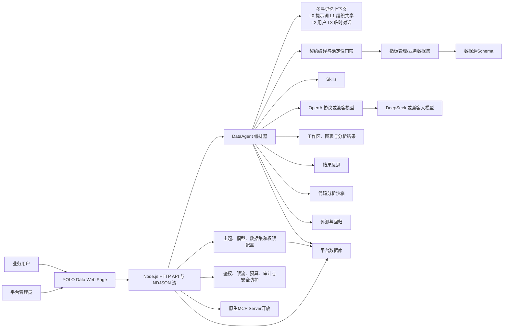

[English](README_EN.md) | 简体中文

# YOLO Data｜企业级智能问数平台

让数据分析像对话一样简单，让结果像流程一样可信。

YOLO Data 面向企业，将多年沉淀的数据分析经验与大模型能力结合，帮助企业简化繁杂的数据处理流程，快速、稳定地完成业务洞察。业务人员可以围绕同一问题多轮追问；当问题需要澄清时，平台会主动反问，确保准确理解业务意图。

不止是智能问答，YOLO Data 将大模型（LLM）、指标体系、业务数据集、数据权限、会话记忆、结果反思和工作区产物，整合为一条完整工作流，让每一次分析都可审计、可复现。

## 主要解决的问题

1. 准确性：传统Text2SQL的架构每次回答不一致，答案随机性强；本产品核心工作流主要解决大模型幻觉问题，准确率提升至95%+。
2. 一致性：语义层不统一，业务各说各话，决策者不知道哪份数据真实。
3. 效率：数据处理“出数>归因>决策>执行”流程过长；效率从小时级别提升到分钟级。

## 项目定位

企业数据问数不能只依赖将数据表Schema扔给大模型，需要大模型能结合上下文将复杂问题进行拆解；通过类似数据加工的方式精准的输出数据结果，能根据问题进行洞察与归因分析。

1. 模型负责理解用户问题、指标口径和字段。
2. 平台负责时间解析、字段映射、查询契约、权限绑定和结果稳定化。
3. 最终查询只能从已治理的指标或业务数据集中执行。
4. 所有关键步骤保留证据，可审计、可复现、可回放。

## 页面截图

 

 


## 核心能力

- **实时指标体系**
  - 对接指标目录、指标详情、口径、维度和聚合查询。
  - 不复制指标库，不把缓存当作指标事实来源。
- **智能体**
  - 每个主题独立配置提示词、模型、Skills、指标范围、数据集范围和默认口径。
  - 一个主题就是一个独立的业务 DataAgent。
- **统一模型管理**
  - 模型新增、编辑、删除、密钥加密、Base URL、温度、工具轮次和平台默认模型管理。
  - 主题可以绑定多个模型，并指定默认运行模型。
- **业务数据集**
  - 支持 MySQL、TiDB、Doris，以及 PostgreSQL 数据源（需安装可选驱动 `pg`，参见 [PostgreSQL 接入](docs/postgresql.md)）。
  - 平台根据字段语义生成只读查询，不向模型暴露原始 SQL。
  - 支持字段同步、抽样、默认枚举值域和数据集查询审计。
  - 支持「智能识别」：抽样数据自动推断时间字段、常用指标与默认时间窗口，管理员确认后写入字段口径。
- **契约先行查询**
  - 自然语言被编译为条件账本和查询契约。
  - 查询契约冻结后才允许执行。
  - 时间范围、权限、排序和结果行序由平台确定性处理。
- **通用分析管线**
  - 支持时间分桶、派生公式、多条件资格筛选、Rollup 计数、多键排序、Top-N 和列投影。
  - 适合连续月份达标、派生排序、复杂客户筛选等场景。
- **数据权限**
  - 主题级、指标级、数据集级授权。
  - 行级策略强制覆盖模型同字段条件。
  - 列级策略支持隐藏和脱敏。
- **多轮会话与工作区**
  - 多层记忆模式(临时、共享、滑动窗口)会话记忆与长期记忆均按用户和主题隔离；长期记忆沉淀成按「用户 × 智能体」的 Markdown 手册，注入摘要、按需检索正文，并自动合并笔记、压缩超长正文。
  - 查询结果、代码执行结果、CSV、JSON、XLSX 输出均保留为工作区产物。
  - 追问优先复用已有数据快照，避免重复取数造成结果漂移。
- **Skills**
  - 支持标准 `SKILL.md` 目录扫描。
  - 公共 Skills 支持管理员上传、启停、删除与引用管理，参见 [Skill 上传与验收](docs/skill-upload.md)。
  - 支持规划前审计、规划约束、执行后结果验证。
  - 平台核心不写死具体行业口径。
- **可观测性**
  - 十四阶段 DataAgent Workflow，包含执行后反思（REFLECT）与有限次换策略重规划。
  - 流式执行事件、工具调用、查询计划、LLM Token、反馈和知识缺口。
- **MCP接入**
  - 通过 Streamable HTTP `/mcp` 暴露 `list_metrics`、`get_policy`、`get_snapshot`、`resolve_query`、`execute_query` 五个工具。
  - 查询必须先解析契约再执行；详见 [MCP 连接器](mcp-connector/README.md)。
- **生产化加固**
  - 支持提示注入清洗、每日 Token 预算、会话登录，以及 Docker/Podman + seccomp 代码执行隔离。
  - 默认 `inprocess` 仅适合可信环境；多租户部署应配置 `SANDBOX_BACKEND=container` 或 `podman`。

## 业务规则与提示词设置

提示词用于展示效果或结论能够按照业务要求自由定义；业务词、枚举映射、计算公式和默认口径应放在：

- 主题提示词，参考docs/theme-prompts/sales-operation.md
- 数据集字段说明
- 默认值域配置


## 总体架构

记忆上下文采用六层模型：L0 系统提示词、L1 共享组织记忆、L2 长期用户记忆（语义与程序）、L3 对话滑动窗口、L4 临时工作记忆、L5 元记忆与检索。L5 负责确定性检索、前置注入和按需工具调度，横切记忆捕获、整合、压缩和度量。

图中的治理与安全域覆盖鉴权、限流、Token 成本预算、提示注入清洗、确定性门禁、审计和代码执行隔离；外部接入域覆盖 MCP 查询和 L1/L2/L3 回归评测。




## 环境要求

- Node.js `>= 22.5`（平台库使用 Node 内置 `node:sqlite`，无需安装数据库服务）
- npm 或 pnpm
- Python 3：用于高级数据处理和文件生成。`npm run setup` 会自动创建 `.venv` 并安装 `pandas`、`openpyxl`
- 或：Docker + Docker Compose，一条命令启动完整平台，无需本机 Node/Python（见 [Docker 一键部署](#docker-一键部署)）
- 可选外部服务：
  - 指标平台
  - Doris 或 MySQL 兼容业务数据库
  - DeepSeek 或其他 OpenAI 兼容模型服务

## 快速开始

```bash
# 克隆仓库
git clone https://github.com/xiaour/yolo-data.git yolo-data
cd yolo-data
docker compose up -d --build
```
```bash
docker build -t yolo-data .
docker run -d -p 8088:8088 -v yolo-data:/app/data --restart unless-stopped yolo-data
```

默认镜像包含 MySQL 兼容驱动、Python 3、`pandas` 和 `openpyxl`。PostgreSQL 需要在构建时启用可选的 `pg` 驱动：

```bash
# Compose（POSIX shell；PowerShell 先执行 $env:INSTALL_PG='true'）
INSTALL_PG=true docker compose up -d --build
# 或直接构建
docker build --build-arg INSTALL_PG=true -t yolo-data .
```

`INSTALL_PG` 是构建参数，修改后需要重新构建镜像。Python 分析依赖会在镜像构建期校验，缺失时构建直接失败。

数据卷 `/app/data` 保存 SQLite 数据库、数据源加密密钥和分析产物。`docker compose down` 后重新启动会保留数据；`docker compose down -v` 会删除数据卷。备份与迁移时应停止服务并保存整个数据卷，数据库和 `.datasource-key` 必须一起保留。

`docker compose ps` 可查看容器健康状态，`docker compose logs yolo-data` 可查看启动日志。Compose 默认启用 `session` 登录，并且只绑定 `127.0.0.1`；局域网调试可显式设置 `AUTH_MODE=dev` 和 `HOST_BIND=0.0.0.0`，但不要直接暴露到公网。生产环境通过 HTTPS 反向代理访问，参见下方生产部署说明。

### 本地启动

本地初始化（会自动创建 Python `.venv` 并安装分析依赖）：

```bash
npm run setup          # 安装 Node/Python 依赖并生成 .env
# 按需编辑 .env 中的模型密钥、指标平台、Doris 连接
npm run dev            # 启动，默认 http://localhost:8088/
```

PostgreSQL 仅在使用 PostgreSQL 数据源时额外安装可选驱动 `pg`：

```bash
npm install pg
```

打开：

```text
http://localhost:8088/
```
| 用户名               | 显示名称  | 角色        | 默认口令         |
| ----------------- | ----- | --------- | ------------ |
| `admin`           | 平台管理员 | `ADMIN`   | `yolo123456` |
| `east_manager`    | 区域经理  | `ANALYST` | `yolo123456` |
| `channel_analyst` | 渠道分析员 | `ANALYST` | `yolo123456` |


### 登录与会话

- 角色分管理员与分析员：管理员管理平台，分析员只能查看已授权智能体并用其问数。

## 配置说明

### OpenAI协议模型(推荐DeepSeek)

- 智能体可以选择一个或多个模型，并指定默认模型。

### 业务数据集
支持 MySQL、TiDB、Doris，以及 PostgreSQL 数据源（需安装可选驱动 `pg`，参见 [PostgreSQL 接入](docs/postgresql.md)）。查询由平台根据字段语义编译，模型不会直接提交原始 SQL。

#### 数据集智能识别

数据集列表的「智能识别」入口会自动推断字段角色（`TIME/METRIC/DIMENSION/IDENTIFIER`）、  
聚合方式与默认时间窗口，管理员逐项确认后写回既有配置面，减少问数时的口径与时间范围追问。

#### 字段启用与禁用

「字段」弹窗支持逐个字段启用/禁用，**默认全部启用**。数据集列表与「智能体 → 数据范围」共用同一入口，  
两边修改的是同一份配置。agent 与查询链路统一按启用读取字段，禁用字段不可作为维度/指标/时间字段或筛选条件。  
「同步结构」会保留禁用状态。

## API 示例

### 流式问数

```bash
curl -N -X POST http://localhost:8088/api/chat/query/stream \
  -H 'Content-Type: application/json' \
  -b cookie.txt \
  -d '{
    "themeId": 1,
    "question": "8月各渠道销售额环比变化如何？"
  }'
```

## 安全与治理

- 对外部署前必须先打开会话鉴权。
- 不向模型暴露原始 SQL。
- 数据集查询使用平台自有只读查询构建器。
- 行级权限在执行层强制生效，列级权限在浏览器返回前执行。
- 数据源密码和模型密钥加密保存。
- 关键操作写入审计日志。
- 上传文件进入模型上下文前默认执行提示注入清洗。
- 可设置每日 Token 上限。
- 当前应用支持 `AUTH_MODE=dev` / `session`；对外部署使用 `session`。OIDC/JWT 模块尚未接入应用鉴权流程，`AUTH_MODE=oidc` 会阻止启动。

## 生产化注意事项

- `docker compose up -d` 默认使用 `AUTH_MODE=session` 且仅绑定 `127.0.0.1`。对外部署仍必须修改默认口令，并在 HTTPS 反向代理后运行；`NODE_ENV=production` 下直接用 HTTP 访问会因 Secure Cookie 导致登录失败。
- 代码执行默认 `SANDBOX_BACKEND=inprocess`，这不是安全边界。不可信用户场景应配置 Docker/Podman 容器、seccomp、无网络和只读根文件系统。
- 平台状态当前使用 SQLite，应按单实例部署。`DATABASE_BACKEND` 和 `REDIS_URL` 尚未接入应用启动流程，设置它们不会切换平台存储或启用分布式会话锁；多实例部署仍需完成外部平台库和锁的集成。PostgreSQL 业务数据源支持不代表平台状态可存入 PostgreSQL。
- `REFLECTION_ENABLED` 与 `REFLECTION_MAX_REPLAN` 控制执行后反思；`npm run eval` 或 `/api/eval` 可查看 L1/L2/L3 回归评测。

## 相关文档

- [系统架构](docs/architecture.md)
- [长期记忆架构](docs/memory-architecture.md)
- [PostgreSQL 接入](docs/postgresql.md)
- [MCP 连接器](mcp-connector/README.md)
- [P0 加固报告](P0-HARDENING-REPORT.md)

## 参与贡献

欢迎参与贡献，请保持以下边界：

- 业务特定映射不要写入平台核心代码。
- 保持 Contract-first【契约先行】 执行和权限强制。
- 文件体积只降不升，不要静默抬高基线。
- 新工作流或回归修复应补充对应测试。
- 不要从本仓库修改外部指标平台项目。

更详细的设计说明请查看 [docs/architecture.md](docs/architecture.md)。

## 许可证

Apache License 2.0 详见 [LICENSE](LICENSE)。
