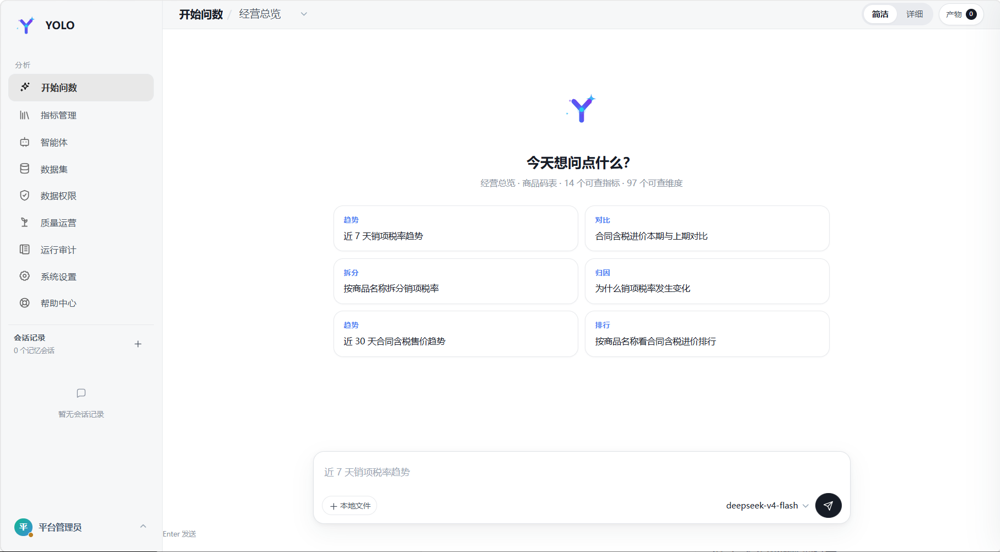
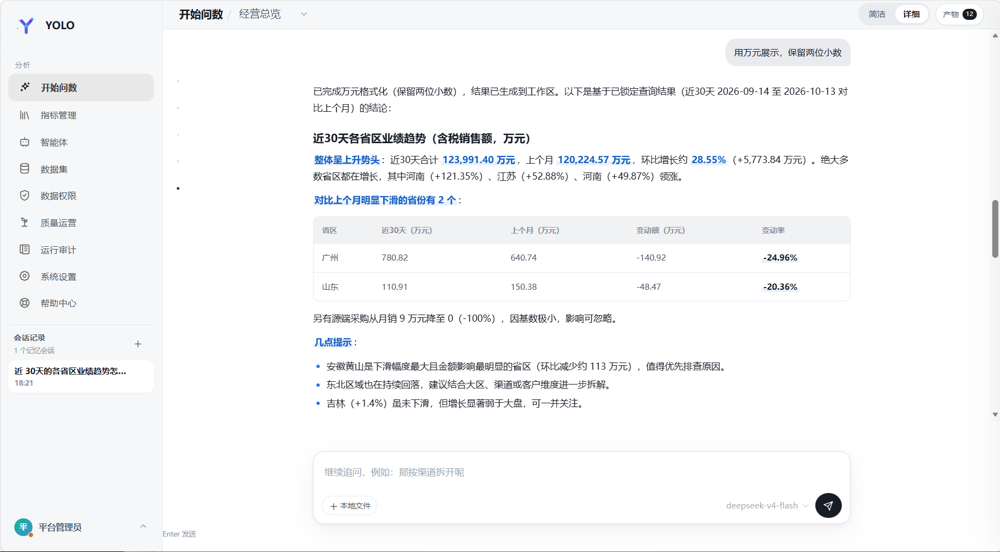
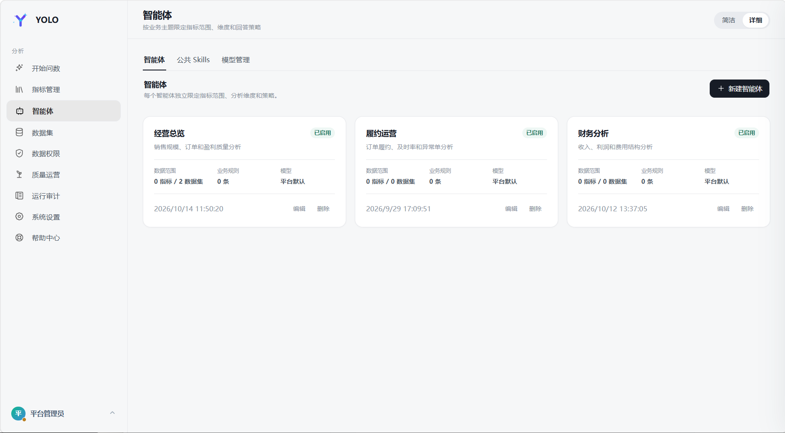
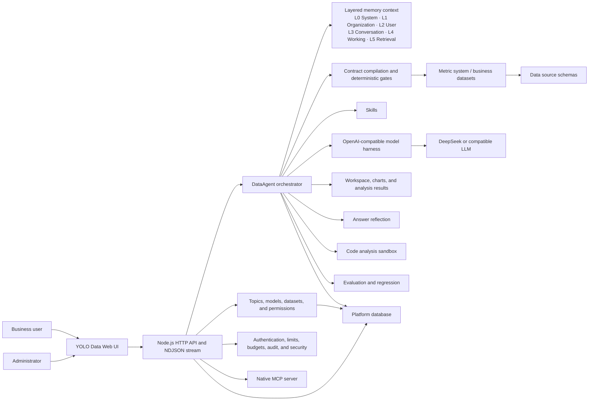

[简体中文](README.md) | English

# YOLO Data | Enterprise Conversational Analytics Platform

Make data analysis as simple as a conversation and its results as trustworthy as a governed process.

YOLO Data combines years of data-analysis practice with large language models to simplify complex enterprise data workflows and deliver fast, stable business insights. Business users can ask follow-up questions in the same conversation, while the platform requests clarification whenever the business intent is ambiguous.

Beyond conversational Q&A, YOLO Data brings LLMs, metric definitions, business datasets, data permissions, layered memory, answer reflection, and workspace artifacts into one auditable and reproducible workflow.

## Problems It Solves

1. **Accuracy:** conventional Text-to-SQL systems can produce inconsistent answers. YOLO Data uses governed contracts and deterministic execution to reduce hallucinations and target 95%+ accuracy.
2. **Consistency:** a unified semantic layer prevents teams from using conflicting definitions for the same business concept.
3. **Efficiency:** the path from data retrieval to attribution, decision, and action is shortened from hours to minutes.

## Positioning

Enterprise analytics requires more than sending database schemas to an LLM. The model must understand context and decompose complex questions, while the platform must produce precise data and support insight and attribution analysis.

1. The model interprets user questions, metric definitions, and fields.
2. The platform handles time parsing, field mapping, query contracts, permissions, and result stabilization.
3. Queries execute only against governed metrics or business datasets.
4. Every critical step retains evidence for auditing, reproduction, and replay.

## Screenshots







## Core Capabilities

- **Real-time metric system**
  - Connects to metric catalogs, definitions, dimensions, and aggregate queries.
  - Does not copy the metric repository or treat caches as a source of truth.
- **DataAgents**
  - Each topic independently configures prompts, models, Skills, metric scope, dataset scope, and default business definitions.
  - Each topic acts as an independent business DataAgent.
- **Unified model management**
  - Model creation, editing, deletion, encrypted credentials, Base URL, temperature, tool rounds, and platform defaults.
  - A topic can bind multiple models and select its default runtime model.
- **Business datasets**
  - Supports MySQL, TiDB, Doris, and PostgreSQL. PostgreSQL requires the optional `pg` driver; see [PostgreSQL integration](docs/postgresql.md).
  - Generates read-only queries from field semantics without exposing raw SQL to the model.
  - Supports schema synchronization, sampling, default enum domains, and query auditing.
  - Smart recognition infers time fields, common metrics, and default time windows from samples before administrator approval.
- **Contract-first queries**
  - Natural language is compiled into a condition ledger and query contract.
  - Execution is allowed only after the contract is frozen.
  - Time ranges, permissions, sorting, and result ordering are handled deterministically.
- **General analysis pipeline**
  - Supports time buckets, derived formulas, multi-condition qualification, rollup counts, multi-key sorting, Top-N, and column projection.
- **Data permissions**
  - Topic-, metric-, and dataset-level grants.
  - Row policies override model conditions on the same field.
  - Column policies support hiding and masking.
- **Multi-turn conversations and workspaces**
  - Layered memory is isolated by user and topic. Long-term memory is maintained as a versioned Markdown handbook per user and DataAgent, with summary injection, on-demand retrieval, note consolidation, and compaction.
  - Query results, code output, CSV, JSON, and XLSX files remain available as workspace artifacts.
  - Follow-up questions prefer locked snapshots to avoid result drift from unnecessary re-querying.
- **Skills**
  - Scans standard `SKILL.md` directories.
  - Administrators can upload, enable, disable, delete, and inspect shared Skills.
  - Supports pre-planning audits, planning constraints, and post-execution validation.
- **Observability**
  - A 14-stage DataAgent workflow including `REFLECT` and bounded strategy replanning.
  - Streaming execution events, tool calls, query plans, LLM token usage, feedback, and knowledge gaps.
- **MCP integration**
  - Exposes `list_metrics`, `get_policy`, `get_snapshot`, `resolve_query`, and `execute_query` over Streamable HTTP at `/mcp`.
  - Queries must resolve a contract before execution. See the [MCP connector](mcp-connector/README.md).
- **Production hardening**
  - Prompt-injection sanitization, daily token budgets, session authentication, and Docker/Podman plus seccomp execution isolation.
  - The default `inprocess` backend is suitable only for trusted environments. Multi-tenant deployments should use `SANDBOX_BACKEND=container` or `podman`.

## Business Rules and Prompts

Prompts may control presentation and conclusions. Business terminology, enum mappings, formulas, and default definitions should live in:

- Topic prompts, such as `docs/theme-prompts/sales-operation.md`
- Dataset field descriptions
- Default value-domain configuration

## Architecture

The memory context uses six layers: L0 system prompts, L1 shared organizational memory, L2 long-term user memory, L3 conversation window, L4 working memory, and L5 meta-memory and retrieval. Governance covers authentication, rate limits, token budgets, prompt sanitization, deterministic gates, auditing, and code isolation.



## Requirements

- Node.js `>= 22.5` (`node:sqlite` is used, so no separate platform database is required for a single-node setup)
- npm or pnpm
- Python 3 for advanced analysis and file generation. `npm run setup` creates `.venv` and installs `pandas` + `openpyxl`
- Alternatively: Docker and Docker Compose for a complete environment without local Node.js or Python
- Optional external services: a metric platform, Doris/MySQL-compatible business database, and DeepSeek or another OpenAI-compatible model service

## Quick Start

Recommended Docker Compose setup:

```bash
git clone https://github.com/xiaour/yolo-data.git yolo-data
cd yolo-data
docker compose up -d
```

Run directly with Docker:

```bash
docker build -t yolo-data .
docker run -d -p 127.0.0.1:8088:8088 -e AUTH_MODE=session \
  -v yolo-data:/app/data --restart unless-stopped yolo-data
```

Local development (creates the Python virtualenv and installs analysis dependencies):

```bash
npm run setup
# edit .env for model keys, metric platform and database connections
npm run dev
```

Install the optional PostgreSQL driver only when needed:

```bash
npm install pg
```

Open [http://localhost:8088/](http://localhost:8088/).

| Username | Display name | Role | Default password |
| --- | --- | --- | --- |
| `admin` | Platform Administrator | `ADMIN` | `yolo123456` |
| `east_manager` | Regional Manager | `ANALYST` | `yolo123456` |
| `channel_analyst` | Channel Analyst | `ANALYST` | `yolo123456` |

Administrators manage the platform. Analysts can access and query only the DataAgents granted to them.

## Configuration

### OpenAI-compatible models

A DataAgent may use one or more models and select a default model. DeepSeek is recommended but not required.

### Business datasets

MySQL, TiDB, Doris, and PostgreSQL are supported. The platform compiles queries from field semantics, and the model cannot submit raw SQL.

Smart recognition infers field roles (`TIME`, `METRIC`, `DIMENSION`, `IDENTIFIER`), aggregation methods, and default time windows. Administrators review inferred values before saving them.

Fields can be enabled or disabled individually and are enabled by default. Disabled fields cannot be used as dimensions, metrics, time fields, or filters. Schema synchronization preserves their enabled state.

## API Example

### Streaming query

```bash
curl -N -X POST http://localhost:8088/api/chat/query/stream \
  -H 'Content-Type: application/json' \
  -b cookie.txt \
  -d '{
    "themeId": 1,
    "question": "How did sales by channel change month over month in August?"
  }'
```

## Security and Governance

- Enable session authentication before exposing the service externally.
- Raw SQL is never exposed to the model.
- Dataset queries use the platform's read-only query builder.
- Row policies are enforced during execution; column policies are applied before browser delivery.
- Data-source passwords and model credentials are encrypted at rest.
- Critical operations are written to the audit log.
- Uploaded content is sanitized for prompt injection before entering model context.
- Daily token limits can be configured.
- The application supports `AUTH_MODE=dev` / `session`; use `session` for external deployments. The OIDC/JWT module is not integrated into application authentication, and `AUTH_MODE=oidc` prevents startup.

## Production Notes

- `docker compose up -d` defaults to `AUTH_MODE=session` and binds only to `127.0.0.1`. External deployments must still change the default password and run behind an HTTPS reverse proxy. Direct HTTP access with `NODE_ENV=production` will fail login because Secure cookies are required.
- `SANDBOX_BACKEND=inprocess` is not a security boundary. Untrusted environments should use Docker or Podman with seccomp, no network, and a read-only root filesystem.
- Platform state currently uses SQLite; deploy a single instance. `DATABASE_BACKEND` and `REDIS_URL` are not wired into application startup, so setting them does not switch platform storage or enable distributed session locks. Multiple instances still require integration of an external platform database and locking. PostgreSQL business-data sources do not provide PostgreSQL storage for platform state.
- `REFLECTION_ENABLED` and `REFLECTION_MAX_REPLAN` control answer reflection. Run `npm run eval` or use `/api/eval` for L1/L2/L3 regression evaluation.

## Documentation

- [System architecture](docs/architecture.md)
- [Memory architecture](docs/memory-architecture.md)
- [PostgreSQL integration](docs/postgresql.md)
- [MCP connector](mcp-connector/README.md)
- [P0 hardening report](P0-HARDENING-REPORT.md)

## Contributing

- Keep business-specific mappings out of the platform core.
- Preserve contract-first execution and mandatory permission enforcement.
- Do not silently raise file-size baselines.
- Add tests for new workflows and regression fixes.
- Do not modify external metric-platform projects from this repository.

See [docs/architecture.md](docs/architecture.md) for detailed design documentation.

## License

Apache License 2.0. See [LICENSE](LICENSE).
